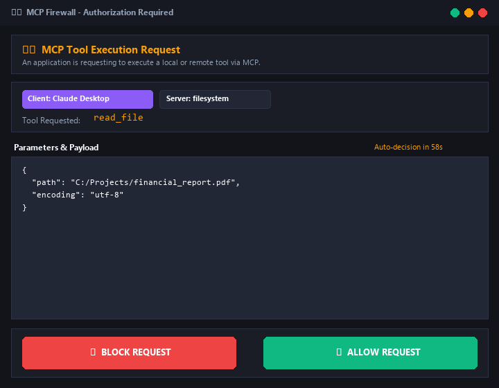

# Demonstration Guide: MCP Firewall

This document provides instructions for running the live interactive demonstration of **MCP Firewall**, verifying request approval and blocking, and recording a video demonstration.

---

## 1. Quick Visual Demonstration

An animated demonstration preview is included in the repository at [`assets/demo.gif`](assets/demo.gif):



---

## 2. Running the Interactive Demo Locally

The repository includes a self-contained demonstration suite that simulates both **Claude Desktop** and **Claude Web** issuing tool calls against an MCP server.

### Prerequisites
- Python 3.10 or higher (Python 3.13 tested and verified)
- Repository dependencies: `pip install -e .`

### Running the Demo
Execute:
```bash
python demo/run_demo.py
```
*(Or via the CLI: `mcp-firewall demo`)*

---

## 3. Walkthrough of Demonstration Scenarios

### Scenario 1: Claude Desktop Request Approved (`read_file`)
1. **Simulation**: The script launches the MCP Stdio wrapper around a mock MCP server.
2. **Action**: The simulated Claude Desktop issues a `tools/call` for `read_file` with parameter `{"path": "secrets/config.json"}`.
3. **Modal Display**: The always-on-top confirmation modal appears immediately above all desktop windows, showing:
   - `Client: Claude Desktop (stdio)`
   - `Server: production-fs`
   - `Tool Requested: read_file`
   - Formatted parameter payload.
4. **User Action**: Click **`[✓ ALLOW REQUEST]`**.
5. **Outcome**:
   - The payload is released to the mock server's `stdin`.
   - The mock server executes the tool.
   - Claude Desktop receives the success result:
     `{"result": {"content": [{"type": "text", "text": "Contents of secrets/config.json: [CONFIDENTIAL DATA - READ SUCCESSFUL]"}], "isError": false}}`

---

### Scenario 2: Claude Desktop Request Blocked (`delete_database`)
1. **Simulation**: Claude Desktop issues a dangerous request to delete a production database:
   `{"database_name": "production_customers", "force": true}`.
2. **Modal Display**: The confirmation modal pops up with the dangerous arguments highlighted in the JSON viewer.
3. **User Action**: Click **`[✕ BLOCK REQUEST]`**.
4. **Outcome**:
   - **Zero bytes are transmitted to the database server.**
   - The database server never runs the delete operation.
   - Claude Desktop receives an MCP-compliant error response:
     ```json
     {
       "result": {
         "content": [
           {
             "type": "text",
             "text": "[MCP FIREWALL BLOCKED]: User rejected the execution of tool 'delete_database'. The operation was NOT executed on the system."
           }
         ],
         "isError": true
       }
     }
     ```

---

### Scenario 3: Claude Web HTTP/SSE Interception
1. **Simulation**: The HTTP/SSE reverse proxy intercepts a tool call initiated via web HTTP POST.
2. **Modal Display**: The modal pops up with a distinct cyan badge:
   - `Client: Claude Web (HTTP/SSE)`
   - `Server: web-tools-server`
   - `Tool: execute_shell_command`
3. **User Action**: Click either Allow or Block to verify web request interception.

---

### Scenario 4: Concurrent Multi-Client Request Handling
1. **Simulation**: Claude Desktop and Claude Web dispatch tool requests at the exact same millisecond.
2. **Modal Display**:
   - The modal automatically manages the request queue:
     `Queue: 1 of 2 pending`
   - Shows navigation buttons: `[◀ Previous]` and `[Next ▶]`.
3. **User Action**: Inspect each request individually and render decisions independently without race conditions.

---

## 4. How to Record a Video Demonstration

To capture a video demonstration file (MP4/WebM) to attach to a GitHub release or README:

### On Windows
1. Open PowerShell in `D:\github\mcp-firewall`.
2. Press **`Win + Alt + R`** (Windows Xbox Game Bar Screen Recorder) or open **OBS Studio**.
3. Run:
   ```bash
   python demo/run_demo.py
   ```
4. Perform the steps:
   - Step 1: Click `[ALLOW]` on the first prompt (`read_file`).
   - Step 2: Click `[BLOCK]` on the second prompt (`delete_database`).
   - Step 3: Approve/Deny the Claude Web prompt.
   - Step 4: Navigate between queued concurrent requests.
5. Press **`Win + Alt + R`** again to stop recording.
6. The video will be saved in your `Videos\Captures` folder.

### On macOS / Linux
- **macOS**: Press `Cmd + Shift + 5` and select "Record Selected Portion".
- **Linux**: Use SimpleScreenRecorder or OBS Studio.
