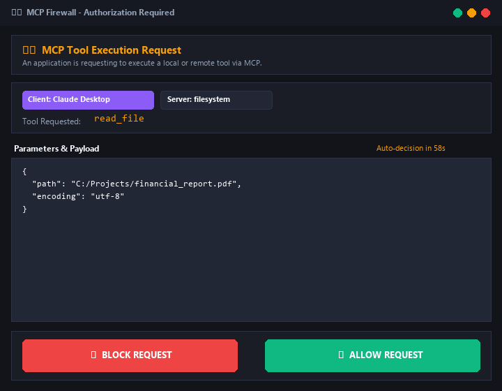

# 🛡️ MCP Firewall

**Real-time monitoring, protocol interception, and user authorization firewall for Model Context Protocol (MCP) communication initiated by Claude Desktop and Claude Web.**

[](https://www.python.org/)
[](LICENSE)
[](https://modelcontextprotocol.io/)
[]()

---

## 📽️ Live Demonstration

The animated demonstration below illustrates MCP Firewall intercepting tool calls from **Claude Desktop** and **Claude Web**, displaying an always-on-top confirmation modal with full parameter inspection, permitting authorized calls, and halting dangerous execution attempts:



> For detailed steps on running the interactive demonstration or recording your own video, see [DEMO_GUIDE.md](DEMO_GUIDE.md).

---

## 📋 Table of Contents
- [Objective & Overview](#objective--overview)
- [Key Features](#key-features)
- [Architecture & Interception Approach](#architecture--interception-approach)
- [Installation](#installation)
- [Configuration & Usage](#configuration--usage)
  - [Claude Desktop Integration (Automatic & Manual)](#1-claude-desktop-integration)
  - [Claude Web Integration (HTTP/SSE Reverse Proxy)](#2-claude-web-integration)
  - [Starting the Background Daemon](#3-running-the-background-daemon)
- [Running the Interactive Demo](#running-the-interactive-demo)
- [CLI Reference](#cli-reference)
- [Evaluation Criteria & Verification](#evaluation-criteria--verification)
- [Project Structure](#project-structure)
- [License](#license)

---

## Objective & Overview

Model Context Protocol (MCP) empowers Claude to execute commands, interact with databases, access the local filesystem, and invoke cloud APIs. However, unmonitored tool execution poses critical security and data safety risks (e.g., unintended deletions, credential leakage, or unauthorized shell commands).

**MCP Firewall** provides a robust, application-level security layer that:
1. **Monitors** all outgoing MCP communication from both **Claude Desktop** and **Claude Web**.
2. **Intercepts** tool invocations (`tools/call`) before they reach target servers.
3. **Suspends** execution and presents an **always-on-top confirmation modal** displaying the server, tool, and formatted arguments.
4. Gives the user total control:
   - **Allow**: Releases the request to execute on the target server.
   - **Block**: Prevents execution and synthesizes an MCP-compliant error response so the conversation continues safely.

---

## Key Features

- **Dual-Client Compatibility**:
  - Full support for **Claude Desktop** via transparent JSON-RPC stdio stream wrapping.
  - Full support for **Claude Web** via an asynchronous HTTP and Server-Sent Events (SSE) reverse proxy.
- **Human-in-the-Loop Confirmation**:
  - Topmost, foreground-enforced UI modal built with Python Tkinter (zero heavy C++ dependencies).
  - Displays client badge, server name, tool name, timestamp, and syntax-highlighted parameter payload.
- **Fail-Safe & Security Defaults**:
  - Default-Deny: If the confirmation modal times out or the window is closed, the request is automatically **BLOCKED**.
  - Non-destructive passthrough: Handshake messages (`initialize`, `tools/list`, `resources/list`) flow seamlessly without annoying interruptions.
- **Concurrency & Queue Management**:
  - Thread-safe approval engine with UUID-based request tracking.
  - Dynamically handles multiple simultaneous requests from different clients with a queue navigator (`Queue: 1 of 3 pending`).
- **Activity Monitoring & Audit Logging**:
  - Persistent JSONL audit trail recording every request, decision, timestamp, and client origin.
  - Optional real-time activity dashboard showing live statistics (Total, Allowed, Blocked).

---

## Architecture & Interception Approach

```
+-----------------------------------------------------------------------------------+
|                                 CLIENT LAYER                                      |
|      Claude Desktop (stdio JSON-RPC)      |      Claude Web (HTTP / SSE)          |
+-------------------------------------------+---------------------------------------+
                     |                                          |
                     v                                          v
+-----------------------------------------------------------------------------------+
|                              INTERCEPTION LAYER                                   |
|   Stdio Wrapper (mcp_firewall.wrap)       |   HTTP / SSE Reverse Proxy (8765)     |
+-------------------------------------------+---------------------------------------+
                     |                                          |
                     +--------------------+---------------------+
                                          | Local IPC Socket (127.0.0.1:9876)
                                          v
+-----------------------------------------------------------------------------------+
|                           APPROVAL ENGINE & DAEMON                                |
|   - Thread-safe request queue & synchronization primitives (threading.Event)     |
|   - Always-on-top Tkinter Confirmation Modal                                      |
|   - Default-deny countdown timer & persistent audit logging (JSONL)               |
+-----------------------------------------------------------------------------------+
                     |                                          |
        [If User Clicks ALLOW]                     [If User Clicks BLOCK]
                     v                                          v
+-----------------------------------------+   +-------------------------------------+
|        TARGET MCP SERVER EXECUTES       |   |      EXECUTION PREVENTED            |
|   Request forwarded to server stdin     |   |   Zero bytes sent to target server  |
|   or upstream network endpoint.         |   |   Returns MCP error CallToolResult  |
+-----------------------------------------+   +-------------------------------------+
```

For the complete technical breakdown, sequence flows, and threading model, read [ARCHITECTURE.md](ARCHITECTURE.md).

---

## Installation

### Prerequisites
- Python 3.10, 3.11, 3.12, or 3.13.
- Windows, macOS, or Linux.
- Tkinter (included by default in standard Python distributions).

### Setup
Clone the repository and install in editable mode:
```bash
git clone https://github.com/<your-username>/mcp-firewall.git
cd mcp-firewall
pip install -e .
```

*Or using `uv`*:
```bash
uv pip install -e .
```

---

## Configuration & Usage

### 1. Claude Desktop Integration

Claude Desktop configures MCP servers in `claude_desktop_config.json`:
- **Windows**: `%APPDATA%\Claude\claude_desktop_config.json`
- **macOS**: `~/Library/Application Support/Claude/claude_desktop_config.json`
- **Linux**: `~/.config/Claude/claude_desktop_config.json`

#### Automatic Configuration (Recommended)
Inspect existing servers:
```bash
mcp-firewall claude-status
```

Wrap all configured servers with MCP Firewall:
```bash
mcp-firewall claude-protect
```
*(MCP Firewall automatically backs up your existing config before making any changes).*

To restore original configuration at any time:
```bash
mcp-firewall claude-unprotect
```

#### Manual Configuration
To manually protect a server, prepend `python -m mcp_firewall wrap --server-name <NAME> --` to the command:
```json
{
  "mcpServers": {
    "filesystem": {
      "command": "python",
      "args": [
        "-m", "mcp_firewall", "wrap",
        "--server-name", "filesystem",
        "--",
        "npx", "-y", "@modelcontextprotocol/server-filesystem", "C:\\Users\\Username\\Documents"
      ]
    }
  }
}
```

---

### 2. Claude Web Integration

For Claude Web or web-based clients that connect to remote MCP servers over HTTP/SSE:

1. Start the HTTP/SSE Reverse Proxy pointing to your upstream MCP server:
   ```bash
   mcp-firewall proxy --port 8765 --upstream http://127.0.0.1:3000 --server-name cloud-tools
   ```
2. In Claude Web, configure the MCP connection URL to:
   ```
   http://127.0.0.1:8765/sse
   ```
3. Whenever Claude Web invokes a tool, MCP Firewall intercepts the incoming HTTP POST request, presents the confirmation modal tagged as **`Client: Claude Web (HTTP/SSE)`**, and forwards or blocks the request based on your decision.

---

### 3. Running the Background Daemon

Run the central daemon to coordinate approvals across all Claude Desktop servers and Claude Web:
```bash
mcp-firewall daemon
```

To also display the live activity dashboard and statistics:
```bash
mcp-firewall daemon --dashboard
```

*(Note: If you invoke a wrapped tool without manually launching the daemon, MCP Firewall will automatically launch the daemon in the background or fall back to a self-contained dialog, ensuring you are never unprotected).*

---

## Running the Interactive Demo

An end-to-end interactive demonstration is included:
```bash
python demo/run_demo.py
```
*(Or `mcp-firewall demo`)*

This script tests and demonstrates:
1. **Scenario 1**: Claude Desktop calls `read_file` -> User clicks **`[ALLOW]`** -> Successful execution.
2. **Scenario 2**: Claude Desktop calls `delete_database` -> User clicks **`[BLOCK]`** -> Operation halted immediately; database server remains untouched.
3. **Scenario 3**: Claude Web calls `execute_shell_command` via HTTP/SSE proxy -> User decision enforced.
4. **Scenario 4**: Concurrent tool invocations from multiple clients simultaneously -> Handled cleanly via the queue manager without race conditions.

---

## CLI Reference

| Command | Arguments | Description |
| :--- | :--- | :--- |
| `mcp-firewall daemon` | `[--port PORT] [--timeout SECONDS] [--dashboard]` | Starts the central authorization daemon and modal engine. |
| `mcp-firewall wrap` | `--server-name NAME [--timeout SECONDS] -- <CMD> [ARGS...]` | Wraps an MCP server's stdio streams (used by Claude Desktop). |
| `mcp-firewall proxy` | `[--port PORT] [--upstream URL] [--server-name NAME]` | Runs the HTTP/SSE reverse proxy for Claude Web. |
| `mcp-firewall claude-status` | *(None)* | Inspects Claude Desktop configuration and lists protected servers. |
| `mcp-firewall claude-protect` | `[--server NAME]` | Automatically wraps servers in `claude_desktop_config.json`. |
| `mcp-firewall claude-unprotect`| `[--server NAME]` | Restores original configuration in `claude_desktop_config.json`. |
| `mcp-firewall demo` | `[--auto]` | Runs the interactive test and demonstration suite. |

---

## Evaluation Criteria & Verification

| Requirement | Implementation & Verification |
| :--- | :--- |
| **1. MCP Communication Monitoring** | Intercepts JSON-RPC over both stdio (Claude Desktop) and HTTP/SSE (Claude Web). Captures server name, tool name, parameters, client origin, and timestamp. |
| **2. User Confirmation Mechanism** | Always-on-top GUI modal (`-topmost True` + Win32 foreground API). Displays full parameter payload with formatted JSON inspection, countdown timer, and Allow/Block buttons. |
| **3. Request Handling** | Holds execution in a suspended state until user decides. If allowed, forwards bytes to server. If blocked, prevents execution and returns an MCP-compliant `CallToolResult` with `isError: true`. |
| **4. Concurrency & Edge Cases** | Handles simultaneous requests across multiple clients with thread-safe synchronization (`threading.Event`, UUID mapping) and queue navigation (`Queue: 1 of N pending`). |
| **5. Application Reliability** | Runs in background. Automatic fallback to embedded modal if daemon is offline. Default-deny on timeout or window closure. Non-blocking error handling. |
| **6. Testing & Documentation** | 17 unit and integration tests passing (`uv run pytest`). Full architectural documentation in [ARCHITECTURE.md](ARCHITECTURE.md) and demo guide in [DEMO_GUIDE.md](DEMO_GUIDE.md). |

---

## Project Structure

```
mcp-firewall/
├── mcp_firewall/
│   ├── __init__.py
│   ├── __main__.py             # Entry point (python -m mcp_firewall)
│   ├── cli.py                  # CLI command parser and handlers
│   ├── config.py               # Configuration constants, paths, timeouts
│   ├── models.py               # MCPRequest, ApprovalDecision, enums
│   ├── protocol.py             # JSON-RPC 2.0 parser & synthetic error generators
│   ├── claude_config.py        # claude_desktop_config.json manager
│   ├── daemon/
│   │   ├── __init__.py
│   │   ├── approval_manager.py # Thread-safe coordinator for requests & queue
│   │   ├── ipc_server.py       # TCP socket server for interceptor connections
│   │   └── ipc_client.py       # Client for submitting requests & auto-spawning
│   ├── ui/
│   │   ├── __init__.py
│   │   ├── theme.py            # Dark theme palette and styling
│   │   ├── popup.py            # Always-on-top Tkinter Confirmation Modal
│   │   └── dashboard.py        # Real-time monitoring metrics & audit history
│   └── interceptors/
│       ├── __init__.py
│       ├── stdio_wrapper.py    # Stdio proxy for Claude Desktop
│       └── http_proxy.py       # HTTP/SSE reverse proxy for Claude Web
├── demo/
│   ├── __init__.py
│   ├── mock_mcp_server.py      # Standalone MCP server with safe & critical tools
│   ├── mock_claude_desktop.py  # Claude Desktop simulator
│   ├── mock_claude_web.py      # Claude Web HTTP/SSE simulator
│   ├── run_demo.py             # Live interactive demonstration runner
│   └── generate_demo_gif.py    # Generates animated GIF and assets
├── tests/
│   ├── test_protocol.py        # JSON-RPC parsing & error generation tests
│   ├── test_models.py          # Data model serialization tests
│   ├── test_approval_manager.py# Threading, concurrency, and timeout tests
│   ├── test_stdio_wrapper.py   # Stdio interception unit tests
│   └── test_http_proxy.py      # HTTP proxy unit tests
├── assets/
│   ├── demo.gif                # Animated demonstration of Allow/Block/Queue
│   └── screenshot_*.png        # High-resolution screenshots
├── ARCHITECTURE.md             # In-depth architectural & security specification
├── DEMO_GUIDE.md               # Guide to running demos and recording video
├── pyproject.toml              # Build specification & dependencies
├── setup.py                    # Package installer
└── README.md                   # Project overview & documentation
```

---

## License

This project is licensed under the MIT License - see the [LICENSE](LICENSE) file for details.
